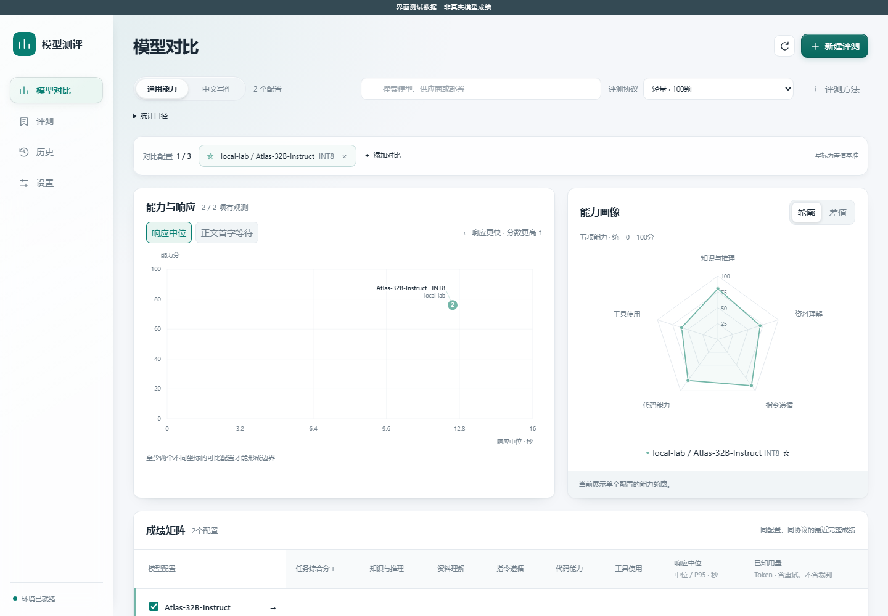

# 模型能力测评

面向 DSH（DeepSeek Harness）已配置模型的本地选型工具。比较量化、微调或不同生成参数下的能力、响应速度和可得用量，保留每次运行和逐题证据。

**当前源码为 `0.1.0-alpha.19` 本地测试候选，测速默认每配置30秒；有部分阶段数据时提供明确标注的宽粗估区间，正式运行持续修正。模型/裁判列表保留紧凑身份展示与玻璃材质。沿用题集准备后的存储自动刷新，以及五项任务综合能力：轻量100题、深入350题、复用100题只补250题。模型比较工作台提供能力与响应散点、观测候选边界、最多3个配置的能力轮廓与差值、成绩矩阵和同配置历史。保留可跳过测速、动态剩余时间和减少动态效果支持。尚未发布 npm 或市场；实现验证与真实模型校准分别记录。**



截图是合成界面数据，不是真实模型成绩。比较以供应商、模型 ID、路由、部署及参数快照为配置身份，按完整评测协议分组；每个配置显示最近完整的轨道成绩，通用能力与中文写作分开。搜索不移除已关注配置，星标可更换差值基准，成绩矩阵支持排序与键盘横滚，并保留原报告和逐题明细入口。

响应为本轮观测，可在响应中位与正文首字等待间切换。只有运行条件已知一致、写作裁判也相同，且存在至少两个不同的非支配坐标时才连观测边界；不同裁判仍可并列查看。缺失指标显示“—”，已知 Token 分项保留，未记录的用量完整性不会被推断为完整。报告历史仅连接同配置、同协议的完整记录，写作跨裁判断线。

## 评测内容

| 子能力 | 固定精选（轻量／深入） | 计分 |
| --- | --- | --- |
| 知识与推理 | MMLU-Pro 24／80题＋OlympiadBench 6／20题 | 最终选项或数值正确性 |
| 资料理解 | LongBench v2 原文限长10／50题，单轮适配 | 最终选项准确率 |
| 指令遵循 | IFEval 多约束30／100题，规则适配版 | 每题全部严格约束通过 |
| 代码能力 | CodeContests 20／70题，测试适配版 | 单候选通过全部保留与增补测试 |
| 工具使用 | BFCL V4 多轮基础场景10／30项，封闭模拟适配 | 整项任务的状态与必要操作全部通过 |
| 独立中文写作 | Ziya 10题＋WritingBench 2题 | 所选裁判按五维0—4判分，12题平均 |

五项各转换为0—100分、各占20%，构成任务综合能力分；写作独立。有效答错按0计，技术缺失不当答错、不缩分母；五项规定内容全部有效判分才出总分。不支持原生工具时显示未测，不以0补齐。轻量资料与工具各10题，单题影响总分2分，小分差不支持稳定排名。轻量是深入的严格子集，每轮全跑所选档位。

这些是**本工具协议下的成绩**，不是来源基准全量官方成绩、IRT 或 Artificial Analysis 同尺度总分。公开题有训练污染、覆盖和重复运行随机性等限制。轻量约30分钟、深入约2—3小时是参考目标，实际取决于部署；使用可选测速查看经验范围。参考解、错误解与本地运行器验证不等于真实模型区分度或时间校准，目前尚未完成真实跨模型校准。

旧版905题与120／400题四项协议、成绩和明细继续保留；新建通用评测默认轻量，比较按完整协议分组，不能把不同试卷总分混排。CodeContests 精选保留全部公开／私有测试，排除已证明违反题面约束的生成用例，增补固定独立反例，差异和来源均记录。新协议每题上限60秒、WASI线性内存512MiB、共享计算量8000亿；旧基线维持原条件。线性内存上限不代表宿主进程总内存上限。

完整轻量记录可显式“补测为深入”：先预览核对同配置、共享题目和评分条件，再独立确认开始。创建关联深入记录，复制全部100题回答及有效成绩（包括答错），仅补250题；来源轻量成绩不变。明细已清理、配置或条件变化时说明原因，不静默全跑。新增用量与“复用部分（此前已发生）”分开，暂停及来源清理后仍可凭独立副本恢复。隐藏服务端默认和静默部署变化仍需用户用部署标签区分。

两项经明确确认的适配：HumanEval/32 保留全部增强输入，以 `find-zero-stable-v1` 组合精确有理数残差、绝对容差和 binary64 表示误差界，没有修补模型代码；自检使用单独命名的稳定参考夹具，原 canonical 保留。IFEval 不装再分发许可未澄清的 Punkt 预训练数据，采用固定 Google 正则分句与开源 Treebank 分词。公开540份回答回归中538一致、2改变，不保证其他回答的差异范围。

协议、逐文件哈希、许可依据在 [资源清单](resources/manifest.json)、[通用协议](resources/protocols/general-chat-v1.json)、[数值适配](resources/protocols/coding-root-oracle-v1.json)、[规则适配](resources/protocols/ifeval-tokenizer-v1.json)；源码中的 `docs/evidence/` 保存分层证据。

## 使用

1. 将本地 tgz 通过目标 DSH profile 的插件入口试装。当前客户端声明为 `web`，Desktop 兼容仅以具体候选版本的实测记录为准。
2. 打开侧栏「模型测评」，在设置中准备环境。题集、可信评分代码、Windows CPython、WASI、Wasmtime 随包提供，不需要额外安装 Python、Docker、WSL，不下载额外数据。
3. 新建评测，选择宿主模型。默认读取宿主参数，可修改本轮温度、最大输出 Token、推理强度、停止词，不写回宿主。可添加同模型的多个配置，可选部署版本区分量化或微调。
4. 选择任务综合能力的轻量或深入档，也可另选中文写作或只测写作。写作另选宿主裁判，不强制厂商或虚构资格分；不支持的参数会明确暂停。
5. 多配置依次执行，每配置同时调用1—4题，默认4，调用超时默认300秒。重型本地评分串行。技术调用最多额外尝试2次，鉴权和配置错误暂停；有效答错不重试。
6. 开始前可跳过，或运行独立测速预览：每配置默认30秒，也可选1—5分钟，多配置依次进行。含该配置写作裁判，最多12次额外调用，不自动重试，样本足够可提前结束。测速按当前生成参数与并发调用，不压缩输出；结束后由你独立点击开始评测。
7. 批次进度卡展示累计 Token（含裁判及可得重试用量）、输入/输出、已用时间与动态预计剩余范围。用量随接口返回更新，缺失部分不补零；已用时间每秒刷新，暂停不计时。估算器按阶段观测与匹配历史修正，每5秒检查无进展的等待。样本不足或调用慢于样本时撤销全程范围；暂停标注当时预估，恢复重新校准。

8. 可手动暂停，退出重开后手动继续。完整回答先落盘再评分；判分故障复用完整回答。未完整保存的调用可能重做并增加用量。

调用走宿主 prepared-call 接口，不读取、另存或内置密钥，不创建匿名服务端口。第三方 adapter 的真实传输/隐藏重试仍需在目标宿主观察，源码检查不代表全链路实测。

写作五维为忠实与准确、逻辑与结构、任务覆盖、简洁与具体、自然与得体。裁判给出理由和可定位引文，不按禁词、分点次数或 AI 检测器判断。合理假设和原题允许的占位不视为捏造。当前覆盖报告、通知、函件、方案、会议整理，**不覆盖完整操作说明书/用户手册**。

更换裁判只填未有效评分项，旧评分、各次裁判快照、尝试、用量保留；可跨裁判并列，混合条件和自评有标注。格式/引文存在验证不等于裁判质量校准。不提供主动重判历史。

每项工具任务最多24个逻辑模型回合、32个动作，跨所有用户轮次共享；技术重试不重置动作与回合预算，成功动作保存后不重复执行。模拟环境只处理固定公开方法与JSON参数，不执行模型代码或真实业务操作。

## 耗时预估的口径

测速额外用量单列，不计入正式评测 Token 或能力成绩，也不把测速答案用于正式题目。可观测 TTFT 是首次输出事件的等待（可能先出现推理），近似 TPOT 仅在流式事件和输出 Token 口径可核对时提供；缺失时仍可按完整请求与本地评分的端到端耗时估算。

预计时间是经验范围。部分阶段未完成时可用同配置的实测耗时、已等待下界与执行预算补出更宽的粗略范围；不会把补估阶段算成实测完成，缺少长资料自身或原生工具调用证据时仍可能无法估计。粗估不是硬上限。按不同题集、待测模型、裁判与本地评分分别取样，模拟并发调用和串行评分。并发、路由、参数、部署、题集协议或裁判变化不能混用条件。实际运行逐步替代测速先验，后续配置分别估算；未完成长请求的等待下界不会被快样本冲掉。暂无真实预测误差认证，范围不表示置信区间或一小时承诺。

停止后先发出取消并阻止新请求，等模型/评分和记录收尾才允许下一任务；供应商不一定立即停止计费。界面关闭后仍有全局测速状态入口。正式报告保留开始前的测速快照与最终预估，来源测速记录清理后快照仍在。

## 本地历史

默认 `~/.dsh-model-eval/`，可切换到其他空目录或本工具目录，不迁移、不删除原目录。切回可看原历史，未知存储版本拒绝修改。同一目录仅一个写者，其他实例只读。

历史有独立的“评测记录”和“测速记录”页签。测速可按会话选择并预览实际容量、清理进度、剩余和未确认量，不影响正式摘要或已关联快照。

每轮独立 ID；供应商/服务路由、模型 ID、有效参数及可选部署标签构成比较对象。服务端未公开默认值或静默换部署无法自动识别，需要部署标签。看板按轨道与协议取最近完整成绩，未完成新任务不会覆盖它。

可多选批次清理明细。保留成绩、写作五维汇总、配置、裁判条件、速度用量，删除逐题回答、尝试与判分明细。活动批次不可清理，未完成批次清理后不能续测。预计、确认删除、剩余及崩溃边界无法归属的字节分列，部分失败可重试。容量是文件字节，不是磁盘分配块。

只累计接口提供的用量，未知不填零，推理/缓存不重复相加，可得失败用量保留。正常完整调用报告中位/P95与可观察首正文耗时；活动时间排除排队、暂停和离线间隔，异常尾部标不完整。无价格不推算金额。

## 开发与证据

开发环境：Windows x64、Node24.21.0。ESM Host 与宿主 React ModuleLoader Client，零运行时 npm dependencies，无安装脚本。

```powershell
npm ci --ignore-scripts
npm run typecheck
npm run build
npm test
npm run test:ui -- --project=chromium
npm pack --ignore-scripts
node scripts/verify-package.mjs <本地包路径.tgz>
```

UI 测试需要开发机 Playwright Chromium；`scripts/preview.mjs` 仅为127.0.0.1合成数据预览，不进入插件包，用户不需要开发依赖。

不可信代码只进入只读 WASI，无 guest 宿主目录、网络或进程能力，Host 持有预期值并比较，限制内存、计算、墙钟和输出并可取消。原生评分环境仅执行固定可信代码。哈希和当前隔离回归不是未来引擎漏洞的绝对安全证明。

证据按资源、运行器、历史/队列、UI、实际包与真实宿主分别记录。进程崩溃测试不等于断电耐久；合成模型不等于真实评测；本地 UI 不等于宿主主题/桌面兼容。见源码中的 [验收记录](docs/evidence/acceptance.json)。

## 许可

自有代码 MIT；第三方资源遵循各自许可，见 `resources/licenses/`、组件 notices 与清单。Tiny 子集及示例映射核对 parent 数据集 MIT 依据，原 tiny card 无单独声明。WritingBench 两条材料未标独立外部来源，定向审查未见冲突，不是第三方权属认证。WASI 无上游完整 SBOM，组件记录不宣称完成链接成分审计。

本仓不含内部指南、地址、业务数据或真实凭据。代码推送、包发布、市场收录与实际可安装分别记录。
