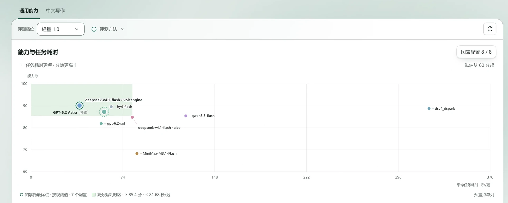
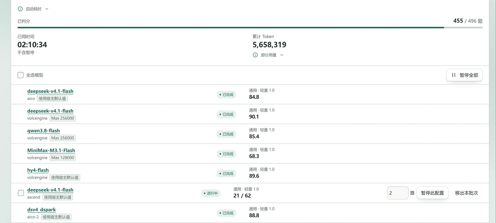
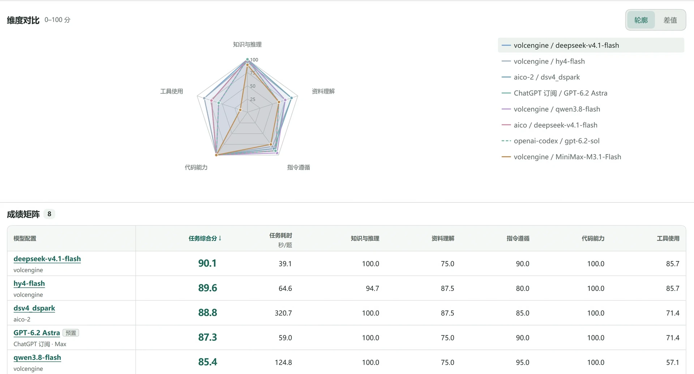

# Model Coordinates（模型坐标）

用同一套任务比较 DSH（DeepSeek Harness）里已配置的模型。既可以横比不同模型，也可以比较同一模型的量化版本、部署或推理参数，看看哪套配置答得更好、花多少时间。

Compare DSH models and configurations on the same tasks using scores, task time, and per-item evidence.

## 能做什么

- **测通用能力和中文写作。** 通用能力覆盖知识与推理、资料理解、指令遵循、编程和工具调用。轻量档 62 题，适合先跑一轮；深入档 348 题。中文写作 12 题，可单独测。
- **把分数和耗时放在同一张图上。** 在「模型对比」看成绩与平均任务耗时，也能按维度比较、给成绩矩阵排序。点开报告，可回看逐题答卷、判分和接口返回的用量。
- **长任务不用从头跑。** 评测可以暂停再继续；已有完整答卷时可只补判。满足同模型、部署、参数和评分条件时，完整轻量记录可「补测为深入」，复用原答卷和成绩。
- **开跑前先看要花多久。** 「查看用时参考」能读本机同配置的历史实测，也可按需做短测速。这里关注做完任务要多久，不做推理服务的并发容量压测。

> 截图中的成绩和耗时仅供参考，受模型部署、参数和运行条件影响，不代表通用排名。轻量档只有 62 题，适合初筛，覆盖不如深入档全面；分差较小或需要做更全面的比较时，建议用深入档复核。

## 快速上手

**当前版本 0.2.3。** 安装包包含 Windows x64 判分资源，要求 DSH `0.2.2-rc.1 || >=0.2.2-rc.3 <0.2.3-0`。

1. 在 [GitHub Releases](https://github.com/ZhangZhengruiNUS/dsh-plugin-model-eval/releases) 下载 `dsh-model-coordinates.tgz`，在 DSH 插件管理中选「安装第三方插件」，然后启用插件。
2. 打开侧栏「模型评测」，点击「新建评测」。选好 DSH 里已经配置的模型；想比较同一模型的两套参数，可以把它加入两次，分别设置本轮参数。首次打开会在后台准备题集和判分资源，不调用模型。
3. 第一次建议选「轻量」并点「开始评测」。想测中文写作可以单独选；比较多个写作配置时使用同一个裁判。「评测任务」里可以看进度、暂停或继续。
4. 完成后打开「模型对比」，选对应类别和版本。从散点图看分数与耗时，再点「查看报告」核对差异来自哪些题。分数只适用于本工具的同一评测协议，不等于官方基准成绩。

**费用和数据：** 评测、模型裁判和主动测速都会由 DSH 向所选供应商发送请求，可能产生用量或费用。查看历史和估时参考不会发请求；短测速须手动点「开始测速」。答卷和报告保存在本机，插件不另存 API 密钥。

## 界面预览

**评测任务**：查看已判分题数、耗时和 Token 用量，也可单独暂停某套配置。

**维度对比与成绩矩阵**：用雷达图看各项能力，再按分数或耗时排序。图中为轻量档实测示例，成绩仅供参考。

## 进阶阅读

- [评测使用与结果说明](docs/user-guide.md)：了解判分规则、补测条件、用量与历史记录。
- [评测版本与归档](docs/design/protocol-releases.md)：为什么不同协议的成绩不混排，以及如何继续使用旧记录。
- GitHub 发行版默认使用独立目录 `~/.dsh-model-coordinates/`；切换数据目录不会迁移或删除原记录。

## 开发与许可

[更新日志](https://github.com/ZhangZhengruiNUS/dsh-plugin-model-eval/blob/codex/model-eval-mvp/CHANGELOG.md) · [开发与发布](https://github.com/ZhangZhengruiNUS/dsh-plugin-model-eval/blob/codex/model-eval-mvp/docs/releasing.md) · [第三方来源与许可](THIRD-PARTY-NOTICES.md)。自有代码采用 MIT；随包题集与运行时适用各自许可。
