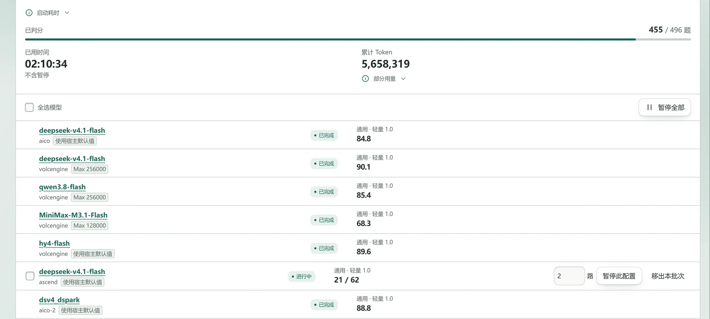
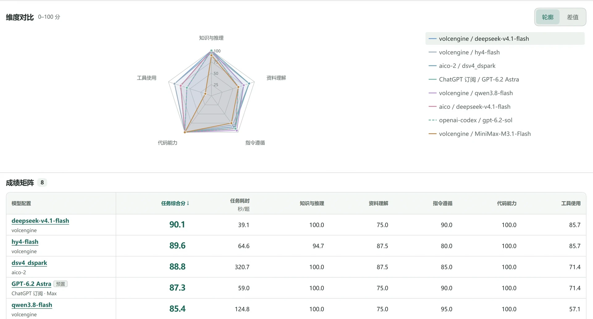

# 评测使用与结果说明

第一次使用请先看 [快速上手](../README.md#快速上手)。本页说明如何选档位、读报告，以及哪些成绩可以比较。

## 题集与评分

| 能力 | 题集来源（轻量／深入） | 怎么判分 |
| --- | --- | --- |
| 知识与推理 | 原创选择 6／28，MMLU-Pro 10／52，OlympiadBench 3／19 | 检查最终选项或数值 |
| 资料理解 | LongBench v2 限长、单轮适配 8／50 | 检查最终选项 |
| 指令遵循 | IFEval 规则适配 20／100 | 必须满足每题所有严格约束 |
| 代码能力 | 原创编程 8／70 | Python 程序必须通过全部测试 |
| 工具使用 | BFCL V4 多轮基础场景 7／29 | 核对必要操作及最终状态 |
| 中文写作 | Ziya 9 题及原创 3 题 | 裁判逐题按五个维度评分，单独出成绩 |

- 通用五项各换算为 0–100 分、各占 20%。有效答错记 0 分，网络或技术故障保留为待补项；模型不支持原生工具调用时，该项显示未测，不用 0 分填补。五项均完成规定判分才生成综合分。
- 写作按忠实与准确、逻辑与结构、任务覆盖、简洁与具体、自然与得体五项各打 0–4 分，12 题取平均。报告能看到评分理由与引用片段。覆盖报告、通知、函件、方案和会议整理，不覆盖完整操作说明书。比较多套配置时使用统一裁判；更换裁判只补缺失成绩，不覆盖已有判分。
- 工具题在封闭环境中模拟业务动作，不操作真实系统。每场最多 24 个逻辑模型回合、32 个动作；重试不重置预算，已保存的成功动作不会重复执行。编程答卷在有时间、计算量、内存和输出限制的 WASI 环境中运行，不提供宿主目录、网络或进程能力。
- 分数只适用于本题集与评分协议，不等同于原基准的官方成绩。公开题可能有训练污染，轻量档几分的差距不宜当成稳定排名。

## 评测、续测与升档

*图中为一次运行示例，耗时与用量仅供参考。*

- 「新建评测」默认读 DSH 的模型参数，可为本轮覆盖温度、输出 Token 上限、推理强度或停止词，不会改写宿主配置。量化、微调或部署调整如果没有反映在路由和模型 ID 上，用部署标签区分。
- 默认每套配置的题目并发数为 4，连续 300 秒没有新输出会把异常题留待补测。瞬时网络故障及服务过载按规则有限重试；某个配置持续失败时，其他配置仍可继续。多套配置共用同一供应商额度时，可在「评测任务」调低并发。报告的「调用尝试」保留接口可提供的脱敏诊断信息。
- 评测可暂停再继续。已有完整答卷、只是判分未完成时，选择仅补判可复用答卷，无需再次调用模型。开启「开发诊断」后，还可在编程题明细重放已保存代码，查看耗时和失败原因；诊断不覆盖原成绩。
- 完整的原生轻量成绩、答卷和共享协议仍在，且模型、部署、参数和评分条件匹配时，从报告点「补测为深入」，先检查预览再确认。现行轻量 62 题可以复用，深入档只需补 286 题。补测生成关联记录，保留原成绩；离线复判记录不能作为升档来源。个别旧协议支持「补测到新版」，只复用已核验的共同题。

## 怎么看对比图

*截图中的分数和耗时仅供参考。轻量档适合初筛，题量和覆盖面有限，几分的差距不宜当成稳定排名。*

- 「模型对比」按评测类别和版本展示各配置最近一次完整成绩；同一模型换供应商、路由、部署或有效参数，会作为独立配置。通用能力与写作不混排。未完成的新任务不会盖掉之前的完整成绩。
- 散点图把成绩与平均任务耗时放在一起。「图表配置」只筛选图表，成绩矩阵仍列出该评测范围内所有配置，可排序并打开报告。内置参考是单独标注的实测汇总，不是你本机跑出的成绩；比较时请核对运行条件与裁判。
- 平均任务耗时按能力权重汇总作答时间，包括失败尝试和自动重试等待；工具题计完整多轮过程，不含本地判分。旧记录缺少完整计时就不出耗时坐标，不拿短测速或单次请求时长替代。调用中位数、P95、首个正文输出等待时间和接口能提供的 Token 用量另见详情。用量未知不当作 0；没有价格信息不估算金额。
- 同一运行条件、同一写作裁判下至少有两个在分数和耗时之间各有优势的点时，图中才会连出对比边界。报告的历史趋势只连接同配置、同协议的完整记录；写作换裁判时断线。

## 估时、调用与本地记录

- 「查看用时参考」可直接读取同配置的历史实测，不调用模型。「开始测速」可采集短样本，默认每配置最多 60 秒，可在 15–300 秒范围内调整。短测速不运行完整竞赛题，额外用量单独记账，不算入正式成绩；停止后供应商不一定立即停止计费。
- 估时是跑完首轮的参考，不包含之后的补测。现场进度按活跃运行时间更新，暂停、排队和离线间隔不按实际作答计入。可观测 TTFT 可能先于正文（例如先输出推理），TPOT 仅在输出事件与 Token 口径可核对时近似计算。这不是部署压测数据。
- 评测、模型裁判和主动测速由 DSH 向所选供应商发请求；插件不另存密钥。资源准备和历史读取不调用模型。
- 历史分开保存评测、测速和估时记录。切换目录不会迁移或删除原记录；同一目录只有一个写入者。清理逐题明细会保留汇总成绩、配置与用量，但被清理的答卷不可再用于续测、补判或升档。正常清理测速、估时记录不影响报告中已保存的快照。

## 评测版本、来源与许可

[评测版本与归档](design/protocol-releases.md)说明新旧题集、合格的比较范围以及旧成绩如何读取。离线复判保留原答卷、原成绩和原计时，结果单独记录，不新增模型调用，也不当成新的效率实测点。

- [资源清单](../resources/manifest.json)记录逐文件校验值；[通用评分协议](../resources/protocols/general-chat-v1.json)记录通用评测口径。历史修订见协议版本与归档说明。
- [编程数值适配](../resources/protocols/coding-root-oracle-v1.json)记录 HumanEval/32 的残差、条件与浮点误差口径；[指令遵循适配](../resources/protocols/ifeval-tokenizer-v1.json)记录固定正则与 Treebank 分词。适配回归不等于真实模型区分度或时间校准。
- 自有代码采用 MIT；题集、运行时和其他第三方资源适用各自许可，见 [第三方来源与许可](../THIRD-PARTY-NOTICES.md)。
